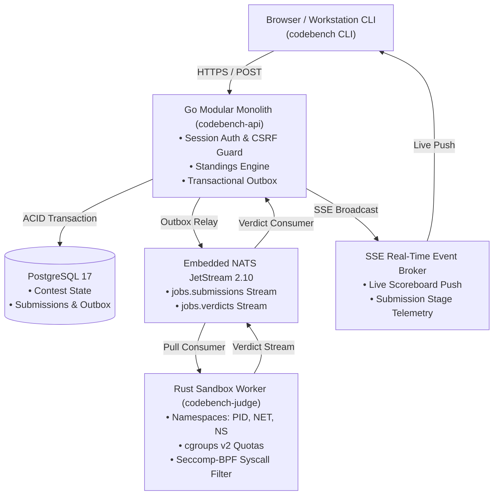

# CodeBench

> **High-throughput, kernel-isolated competitive programming and collegiate contest platform.**  
> Built as a Go modular monolith with an embedded NATS JetStream broker and a bare-metal Linux cgroups v2 / Seccomp-BPF execution sandbox.

---

## 1. Why CodeBench?

Most competitive programming and online judge systems suffer from one of three fatal architectural flaws:
1. **Noisy Neighbor Jitter:** Shared VPS hosts cause reference solutions to fluctuate wildly between Accepted (AC) and Time Limit Exceeded (TLE).
2. **Clock Drift & Client Desync:** Contests relying on participant browser timers suffer from clock skew, giving certain teams extra minutes during freeze windows.
3. **Flaky Distributed Message Queues:** Complex microservice fleets lose submissions during worker restarts or network partitions.

CodeBench was engineered from first principles to solve these operational problems:
- **Server-Authoritative Time Engine:** Every submission timestamp, freeze threshold, and penalty calculation is strictly anchored to monotonic server time.
- **Continuous Timing Canary:** A background benchmark daemon samples reference algorithms every 60 seconds. If host virtualization steal-time causes CPU jitter, linear dilation factors apply dynamically to protect competitors.
- **Zero Event-Loss Transactional Outbox:** Submissions are committed to PostgreSQL within an ACID transaction alongside an outbox event. The relay daemon flushes to embedded NATS JetStream 2.10 every 50ms, guaranteeing at-least-once delivery across restarts.
- **Strict Kernel Containment:** Every untrusted binary executes inside disposable Linux namespaces (`CLONE_NEWPID`, `CLONE_NEWNET`, `CLONE_NEWNS`) constrained by cgroups v2 memory/CPU quotas and strict Seccomp-BPF system call filtering.

---

## 2. Architecture Overview



### Core Components

| Component | Technology | Role |
| :--- | :--- | :--- |
| **API Server** | Go 1.24 | HTTP routing, session auth, transactional outbox relay, scoring algorithms (Collegiate Penalty & Points Decay), SSE broker. |
| **Sandbox Judge** | Rust 1.85 / Linux | High-performance execution runner using `pivot_root`, cgroups v2, and BPF syscall filters. |
| **Message Queue** | Embedded NATS JetStream | High-throughput in-memory messaging with persistent WAL for queueing judge jobs and verdict events. |
| **Database** | PostgreSQL 17 | Relational persistence for users, teams, contests, problems, test suites, submissions, and audit logs. |
| **Web Frontend** | Solid.js + Vite + Tailwind | Zero-overhead, reactive workstation UI with CRT scanline accents, live SSE standings, and Monaco-style editor. |
| **Contest CLI** | Go 1.24 | Local terminal utility for contestants (`codebench submit`) and operators (`codebench tune`, `codebench backup`). |

---

## 3. Kernel Sandbox Security & Defense-in-Depth

Untrusted contestant binaries run under strict defense-in-depth isolation:

```
+-------------------------------------------------------------------+
| Host Linux Kernel                                                 |
|  +-------------------------------------------------------------+  |
|  | Namespace Isolation: CLONE_NEWPID, CLONE_NEWNET, CLONE_NEWNS|  |
|  |  +-------------------------------------------------------+  |  |
|  |  | cgroups v2 Quotas: memory.max=256MB, cpu.max, pids.max |  |  |
|  |  |  +-------------------------------------------------+  |  |  |
|  |  |  | Seccomp-BPF Filter (Whitelist Only)             |  |  |  |
|  |  |  |   Safe: read, write, exit_group, mmap, brk...   |  |  |  |
|  |  |  |   Blocked: socket, connect, ptrace, execve...   |  |  |  |
|  |  |  |  +-------------------------------------------+  |  |  |  |
|  |  |  |  | Untrusted Contestant Binary (UID 10001)   |  |  |  |  |
|  |  |  |  +-------------------------------------------+  |  |  |  |
|  |  |  +-------------------------------------------------+  |  |  |
|  |  +-------------------------------------------------------+  |  |
|  +-------------------------------------------------------------+  |
+-------------------------------------------------------------------+
```

1. **Namespace Isolation:** The binary is placed in its own PID namespace (`PID 1`), Network namespace (`loopback down`), and Mount namespace (`read-only rootfs`).
2. **Resource Constraints:** `memory.max` enforces memory ceilings with `memory.swap.max = 0`. If the binary attempts to exceed limits, the kernel OOM-killer immediately terminates it with a deterministic Memory Limit Exceeded (MLE) verdict. `pids.max = 64` prevents fork bombs.
3. **Seccomp-BPF Filters:** Syscalls like `socket()`, `connect()`, `bind()`, `fork()`, and `execve()` are blocked with `SECCOMP_RET_KILL_PROCESS`. The process cannot exfiltrate test cases or access host credentials.

---

## 4. Supported Compilers & Exact Flags

| Language | Toolchain | Compilation & Execution Flags |
| :--- | :--- | :--- |
| **C++23** | GCC 14.2 | `g++ -O3 -std=c++23 -march=x86-64-v3 -Wall -Wextra -static solution.cpp -o solution` |
| **C++23** | Clang 18 | `clang++ -O3 -std=c++23 -march=x86-64-v3 -stdlib=libc++ solution.cpp -o solution` |
| **C23** | GCC 14.2 | `gcc -O3 -std=c2x -march=x86-64-v3 -Wall -static solution.c -o solution` |
| **Rust** | Rust 1.85 (2024) | `rustc --edition 2024 -C opt-level=3 -C target-cpu=x86-64-v3 solution.rs -o solution` |
| **Python** | Python 3.12 | `python3 -u -B solution.py` *(2.0x time multiplier, +32MB baseline offset)* |
| **Go** | Go 1.24 | `go build -ldflags="-s -w" -o solution solution.go` |

---

## 5. Quickstart

### Prerequisites
- Docker Engine 24+ & Docker Compose v2
- *(Optional for local dev without Docker)* Go 1.24, Node.js 20+, Rust 1.85

### Launch Full Stack with Docker
```bash
# Clone the repository
git clone https://github.com/codebench/codebench.git
cd codebench

# Spin up Postgres, Embedded NATS API, Rust Judge, and Web Frontend
docker compose up -d

# Verify services
docker compose ps
```
The workstation interface will be accessible at `http://localhost:8080`.

### Local Development (Windows / macOS / Linux)
On non-Linux hosts where cgroups v2 is unavailable natively, the backend automatically runs in `USE_FAKE_JUDGE=true` mode for vertical-slice testing:

```bash
# 1. Start backend services
go run ./api/cmd/codebench-api

# 2. Start Vite development server
cd web
npm install
npm run dev
```

---

## 6. Contestant & Operator CLI (`codebench`)

CodeBench provides a unified CLI for both competitors and administrators:

```bash
# Authenticate with the server
codebench login --host http://localhost:8080 --email participant@example.com

# Test a solution against sample testcases locally
codebench test -p two-sum -l cpp23-gcc solution.cpp

# Submit official solution to the running contest
codebench submit -p two-sum -l cpp23-gcc solution.cpp --wait

# View live contest scoreboard
codebench status

# Operator: Calibrate host timing canary baseline
codebench tune --samples 20 --tolerance 0.15

# Operator: Create automated database backup
codebench backup --out ./backups/round1.cbk
```

---

## 7. Problem Package Specification

CodeBench uses self-contained, version-controlled problem packages:

```
problems/two-sum/
├── problem.yaml          # Manifest: slug, limits, checker type, metadata
├── statement.md          # GFM markdown statement with math syntax
├── solution/
│   ├── ref.cpp           # Canonical AC reference solution
│   └── wrong/
│       ├── wa.cpp        # Known Wrong Answer solution for validation
│       └── tle.cpp       # Known Time Limit Exceeded solution
└── tests/
    ├── sample/
    │   ├── 01.in / 01.out
    │   └── 02.in / 02.out
    └── hidden/
        ├── 001.in / 001.out
        └── 002.in / 002.out
```

Validate all problem packages via automated preflight tests:
```bash
go test -v ./tests -run TestSetupAcceptance_Preflight
```

---

## 8. Keyboard Accelerators

Power users can navigate CodeBench without touching the mouse:

| Key | Action |
| :---: | :--- |
| `1` | Jump to Home / Platform Overview |
| `2` | Jump to Competition Arena |
| `3` | Jump to Squad Management |
| `4` | Jump to Live Scoreboard |
| `5` | Jump to Admin Dashboard *(Administrators)* |
| `D` | Open Technical Specifications & Operator Manual |
| `T` | Toggle Dark / Light Obsidian Theme |
| `C` | Toggle Retro CRT Phosphor Scanline Overlay |
| `?` | Show / Hide Keyboard Shortcuts Modal |
| `Esc`| Dismiss Active Modals & Flyouts |

---

## 9. Verification & Test Suite

CodeBench enforces rigorous vertical-slice acceptance testing:

```bash
# Run all Go unit and integration tests (21 packages)
go test ./...

# Run vertical-slice end-to-end integration tests
go test -v -run TestEndToEndVerticalSlice ./api/internal/integration/...

# Build production web bundle
cd web && npm run build
```

---

## 10. License

Licensed under the Apache License, Version 2.0. See [LICENSE](LICENSE) for details.
